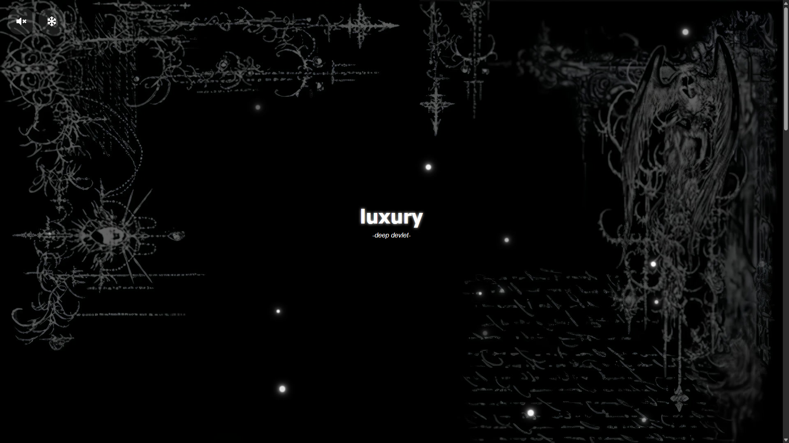
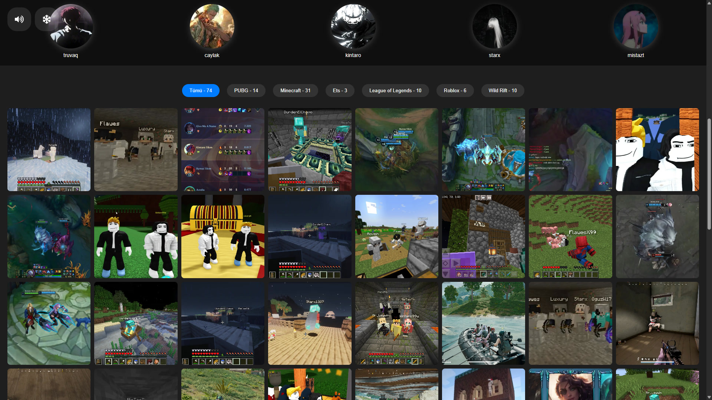

<a href="README.md">
  
</a>
<a href="README-TR.md">
  
</a>

  <br />
  <br />

<div align="center">
  
  <br />
  <br />

  <p>
     Arkadaşlarımla biriktirdiğim oyun anılarını saklayan bir web sitesi.
  </p>


  <p>
    <a href="#demo">Demo</a> •
    <a href="#about">Hakkında</a> •
    <a href="#features">Özellikler</a> •
    <a href="#tech">Teknolojiler</a> •
    <a href="#setup">Kurulum</a> •
    <a href="#gallery">Galeri</a> •
    <a href="#license">Lisans</a>
  </p>

  <br />
  <br />
</div>

## <a id="demo"></a> 📷 Demo

- [https://xkintaro.github.io/memories/](https://xkintaro.github.io/memories/)

## <a id="about"></a> 📋 Hakkında

Bu web sitesini React öğrenmeye başladığım dönemde, arkadaşlarımla biriktirdiğim oyun anılarını saklamak için hazırladım. PUBG, Minecraft, Euro Truck Simulator, League of Legends, Roblox ve Wild Rift'teki ekran görüntülerimizi arkadaşlarımın profil kartlarıyla birlikte gösterir. Arayüz Türkçedir.

## <a id="features"></a> ✨ Özellikler

- **Dinamik banner**: Sayfa açıkken banner'daki selamlama ve yazı tipi rastgele değişir.
- **Arka plan müziği**: Müziği çalın, sesini ayarlayın ya da kapatın.
- **Arkadaş listesi**: Arkadaşların profil kartları rastgele sırayla gösterilir ve otomatik olarak kayar.
- **Kategorili galeri**: Anıları oyuna göre filtreleyin.
- **Görsel modalı**: Herhangi bir fotoğrafı tam boyutta açın.
- **Kar efekti**: Kar yağışı efektini açın ya da kapatın.

## <a id="tech"></a> 🛠️ Teknolojiler

`React` · `Vite` · `CSS` · `React Icons`

## <a id="setup"></a> 🚀 Kurulum

### Gereksinimler

- **Node.js**

### Adım Adım Kurulum

1. **Depoyu klonlayın**

   ```bash
   git clone https://github.com/xkintaro/memories.git
   cd memories
   ```

2. **Bağımlılıkları yükleyin**

   ```bash
   npm install
   ```

   Windows'ta bunun yerine `install-dependencies.bat` dosyasını çalıştırabilirsiniz.

3. **Geliştirme sunucusunu başlatın**

   ```bash
   npm run dev
   ```

   Windows'ta bunun yerine `run.bat` dosyasını çalıştırabilirsiniz.

Uygulamayı şu adreste açın: [http://localhost:5173](http://localhost:5173).

## <a id="gallery"></a> 🖼️ Galeri





## <a id="license"></a> 📄 Lisans

Bu proje MIT Lisansı altında lisanslanmıştır. Detaylar için [LICENSE](LICENSE) dosyasına bakabilirsiniz.

#

<p align="center">
  <sub>❤️ Developed by "Mustafa TAŞAL" (kintaro)</sub>
</p>
