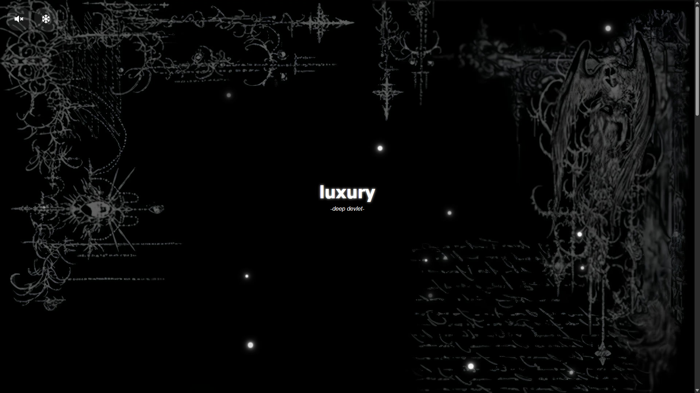
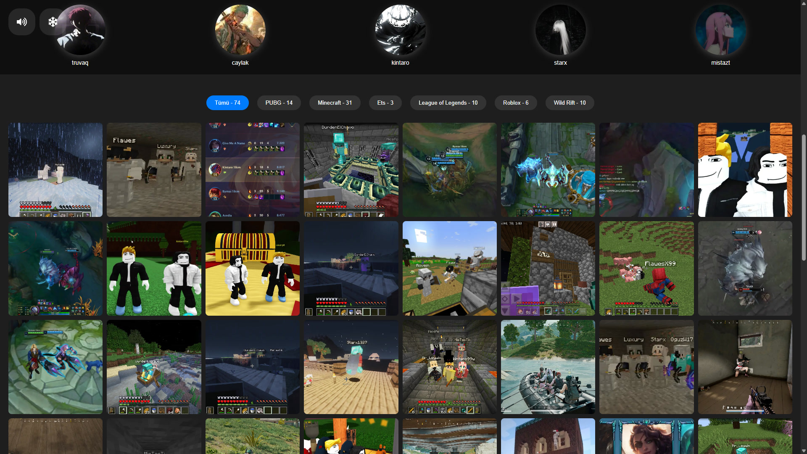

<a href="README.md">
  
</a>
<a href="README-TR.md">
  
</a>

  <br />
  <br />

<div align="center">
  
  <br />
  <br />

  <p>
     A website that keeps the gaming memories I shared with my friends.
  </p>


  <p>
    <a href="#demo">Demo</a> •
    <a href="#about">About</a> •
    <a href="#features">Features</a> •
    <a href="#tech">Tech</a> •
    <a href="#setup">Setup</a> •
    <a href="#gallery">Gallery</a> •
    <a href="#license">License</a>
  </p>

  <br />
  <br />
</div>

## <a id="demo"></a> 📷 Demo

- [https://xkintaro.github.io/memories/](https://xkintaro.github.io/memories/)

## <a id="about"></a> 📋 About

I built this website when I started learning React, to keep the gaming memories I shared with my friends. It shows our screenshots from PUBG, Minecraft, Euro Truck Simulator, League of Legends, Roblox and Wild Rift together with my friends' profile cards. The interface is in Turkish.

## <a id="features"></a> ✨ Features

- **Dynamic banner**: The greeting and the font of the banner change randomly while the page is open.
- **Background music**: Play the music, change the volume or mute it.
- **Friend list**: Friend profile cards are shown in a random order and scroll automatically.
- **Categorized gallery**: Filter the memories by game.
- **Image modal**: Open any photo in full size.
- **Snow effect**: Turn the snowfall effect on or off.

## <a id="tech"></a> 🛠️ Tech

`React` · `Vite` · `CSS` · `React Icons`

## <a id="setup"></a> 🚀 Setup

### Requirements

- **Node.js**

### Step-by-Step Installation

1. **Clone the repository**

   ```bash
   git clone https://github.com/xkintaro/memories.git
   cd memories
   ```

2. **Install dependencies**

   ```bash
   npm install
   ```

   On Windows you can run `install-dependencies.bat` instead.

3. **Start the development server**

   ```bash
   npm run dev
   ```

   On Windows you can run `run.bat` instead.

Open the app at [http://localhost:5173](http://localhost:5173).

## <a id="gallery"></a> 🖼️ Gallery





## <a id="license"></a> 📄 License

This project is licensed under the MIT License. See the [LICENSE](LICENSE) file for details.

#

<p align="center">
  <sub>❤️ Developed by "Mustafa TAŞAL" (kintaro)</sub>
</p>
